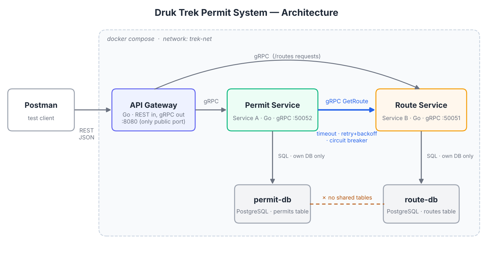

# Druk Trek Permit System 

A small distributed application for issuing **trekking permits in Bhutan**. Tourists
need a permit for a specific trek route (e.g. Jomolhari Trek, Snowman Trek). The system
is split into two microservices written in **Go**, which talk to each other using
**gRPC + Protocol Buffers**, behind a **REST API Gateway**.

| Service | Role in the assignment | Owns | Database |
|---|---|---|---|
| **Route Service** | Service B (independent resource) | Trek routes | `route-db` (PostgreSQL) |
| **Permit Service** | Service A (depends on routes) | Trek permits | `permit-db` (PostgreSQL) |
| **API Gateway** | Single REST entry point | — | — |

A permit can only be issued if the route **exists**, is **open**, and the group is not
larger than the route's **maximum group size**. The Permit Service checks this by
calling the Route Service over gRPC, protected by **timeout, retry with backoff, and a
circuit breaker**.

---

## Architecture



```
Postman ──REST──► API Gateway ──gRPC──► Permit Service ──gRPC (timeout/retry/CB)──► Route Service
                       └────────────────────gRPC (/routes)──────────────────────────┘
                                             │                                         │
                                         permit-db                                  route-db
```

* Postman talks **only** to the gateway (port 8080 is the only published port).
* Each service reads/writes **only its own database** (Database per Service).
  `permits.route_id` is a plain UUID, *not* a foreign key - route data is fetched
  through the Route Service's gRPC API.
* **Bounded contexts:** *Route Catalogue* (what treks exist and their rules) vs.
  *Permit Issuing* (who is trekking where and when).

---

## Project structure

```
druk-trek-permits/
├── proto/
│   ├── route/route.proto        # Route Service contract (CRUD)
│   └── permit/permit.proto      # Permit Service contract (CRUD)
├── gen/                         # Go code generated from the .proto files
├── pkg/
│   ├── config/                  # reads settings from environment variables
│   ├── database/                # PostgreSQL connection with startup retry
│   └── validate/                # shared validation helpers
├── route-service/               # Service B
│   ├── main.go  server.go  repository.go  Dockerfile
├── permit-service/              # Service A
│   ├── main.go  server.go  repository.go
│   ├── routeclient.go           # ★ timeout + retry + circuit breaker
│   └── Dockerfile
├── gateway/                     # REST → gRPC gateway
│   ├── main.go  handlers.go  errors.go (gRPC→HTTP mapping)  Dockerfile
├── postman/DrukTrekPermits.postman_collection.json
├── docs/architecture.png
├── scripts/gen-proto.sh
├── docker-compose.yml
└── .env                         # all ports / DB credentials / resilience settings
```

Each service follows the same simple layering: **`main.go`** (wiring & config) →
**`server.go`** (gRPC handlers + validation) → **`repository.go`** (SQL).

---

## How to run

**Requirement:** Docker Desktop (or Docker Engine + Compose v2). Nothing else.

```bash
git clone <this-repo-url>
cd druk-trek-permits
docker compose up --build
```

Wait until you see `REST gateway listening on :8080`, then check:

```bash
curl http://localhost:8080/health
# {"service":"api-gateway","status":"ok"}
```

Stop everything with `Ctrl+C` then `docker compose down` (add `-v` to also delete the database data).

### Testing with Postman
1. Postman → **Import** → `postman/DrukTrekPermits.postman_collection.json`.
2. Run the folders **in order** (0 → 5). IDs are saved automatically into collection
   variables (`routeId`, `permitId`, …) and `startDate` is always set to 30 days ahead.
3. Before folder **4. Resilience**, stop the Route Service (`docker compose stop route-service`).
   Before folder **5. Cleanup**, start it again (`docker compose start route-service`) and wait ~20 s.

---

## REST API (gateway, port 8080)

| Method | URL | gRPC call | Success |
|---|---|---|---|
| GET | `/health` | – | 200 |
| POST | `/routes` | RouteService.CreateRoute | 201 |
| GET | `/routes` | RouteService.ListRoutes | 200 |
| GET | `/routes/{id}` | RouteService.GetRoute | 200 |
| PUT | `/routes/{id}` | RouteService.UpdateRoute | 200 |
| DELETE | `/routes/{id}` | RouteService.DeleteRoute | 200 |
| GET | `/routes/{id}/permits` | PermitService.ListPermits → RouteService.GetRoute | 200 |
| POST | `/permits` | PermitService.CreatePermit → RouteService.GetRoute | 201 |
| GET | `/permits` (`?route_id=`) | PermitService.ListPermits → RouteService.GetRoute (once per distinct route) | 200 |
| GET | `/permits/{id}` | PermitService.GetPermit → RouteService.GetRoute | 200 |
| PUT | `/permits/{id}` | PermitService.UpdatePermit → RouteService.GetRoute | 200 |
| DELETE | `/permits/{id}` | PermitService.DeletePermit | 200 |

**Create a route**
```json
POST /routes
{ "name": "Jomolhari Trek", "region": "Paro", "difficulty": "HARD",
  "duration_days": 9, "max_group_size": 12, "is_open": true }
```

**Create a permit**
```json
POST /permits
{ "route_id": "<route uuid>", "trekker_name": "Kenji Tanaka",
  "passport_number": "TK1234567", "nationality": "Japan",
  "group_size": 4, "start_date": "2026-11-20" }
```

### gRPC → HTTP error mapping

| gRPC code | HTTP | When |
|---|---|---|
| `INVALID_ARGUMENT` | 400 | validation failed, bad UUID, malformed JSON |
| `NOT_FOUND` | 404 | route/permit does not exist |
| `ALREADY_EXISTS` | 409 | duplicate route name / duplicate permit |
| `FAILED_PRECONDITION` | 422 | route closed, group larger than allowed |
| `UNAVAILABLE` | 503 | Route Service down / circuit breaker open |
| `DEADLINE_EXCEEDED` | 504 | request took too long |
| other | 500 | unexpected error |

Every error has the same JSON shape:
```json
{ "error": { "http_status": 404, "grpc_code": "NOT_FOUND", "message": "route not found" } }
```

---

## Validation rules

| Resource | Field | Rule |
|---|---|---|
| Route | `name` | required, ≤ 100 chars, unique |
| Route | `region` | required, ≤ 60 chars |
| Route | `difficulty` | `EASY`, `MODERATE` or `HARD` (case-insensitive) |
| Route | `duration_days` | 1 – 40 |
| Route | `max_group_size` | 1 – 30 |
| Permit | `route_id` | valid UUID **and** route must exist (checked via gRPC) |
| Permit | `trekker_name`, `nationality` | required |
| Permit | `passport_number` | 6–9 letters/digits (stored upper-case) |
| Permit | `group_size` | 1 – 30 **and** ≤ route's `max_group_size` |
| Permit | `start_date` | `YYYY-MM-DD`, not in the past, within 12 months |
| Permit | `status` (update) | `ISSUED` or `CANCELLED` |
| Both | `id` in URL | valid UUID |

All problems are reported together, and invalid data is **never stored**.

---

## Resilience (Permit Service → Route Service)

Implemented in `permit-service/routeclient.go` as `breaker( retry( timeout( call ) ) )`:

| Pattern | Setting (`.env`) | Behaviour |
|---|---|---|
| Timeout | `ROUTE_CALL_TIMEOUT=2s` | each attempt is cancelled after 2 s |
| Retry + backoff | `ROUTE_MAX_RETRIES=2`, `ROUTE_RETRY_BACKOFF=200ms` | 3 attempts, waiting 200 ms then 400 ms; only `UNAVAILABLE`/`DEADLINE_EXCEEDED` are retried |
| Circuit breaker | `ROUTE_CB_FAILURES=3`, `ROUTE_CB_OPEN_TIMEOUT=15s` | opens after 3 failed calls, rejects instantly for 15 s, then half-open test call |
| Fallback | – | `GET /permits` and `GET /permits/{id}` still return permits with `"route": {"available": false, ...}` |

**Demo:**
```bash
docker compose stop route-service           # simulate an outage
# POST /permits  x3  -> 503 after retries (~0.6 s if refused, up to ~6.6 s if each attempt times out)
# POST /permits  4th -> 503 instantly (circuit OPEN)
# GET  /permits/{id} -> 200 with fallback route info
docker compose logs -f permit-service       # see retries + "closed -> open"
docker compose start route-service          # recover; wait ~15-20 s
# POST /permits -> 201  (log: open -> half-open -> closed)
```
To demo the **timeout** instead of a refused connection, freeze the service:
`docker compose pause route-service` (each attempt now waits the full 2 s → `DEADLINE_EXCEEDED`),
then `docker compose unpause route-service`.

---

## Configuration

All configuration comes from **environment variables** defined in `.env` and passed
in `docker-compose.yml`; nothing is hard-coded in Go. Required variables (ports, DB
host/user/password/name, service addresses) make the service stop with a clear
message if missing.

## Regenerating protobuf code (only if you edit a `.proto`)

```bash
./scripts/gen-proto.sh
```

## Running without Docker (optional)

Start two PostgreSQL databases, then in three terminals:
```bash
ROUTE_GRPC_PORT=50051 DB_HOST=localhost DB_PORT=5433 DB_USER=route_user DB_PASSWORD=route_pass DB_NAME=route_db go run ./route-service
PERMIT_GRPC_PORT=50052 ROUTE_SERVICE_ADDR=localhost:50051 DB_HOST=localhost DB_PORT=5434 DB_USER=permit_user DB_PASSWORD=permit_pass DB_NAME=permit_db go run ./permit-service
GATEWAY_PORT=8080 ROUTE_SERVICE_ADDR=localhost:50051 PERMIT_SERVICE_ADDR=localhost:50052 go run ./gateway
```

## Tech stack
Go 1.23 · gRPC 1.67 · Protocol Buffers · PostgreSQL 16 · `sony/gobreaker` · `lib/pq` · Docker multi-stage builds · Docker Compose
